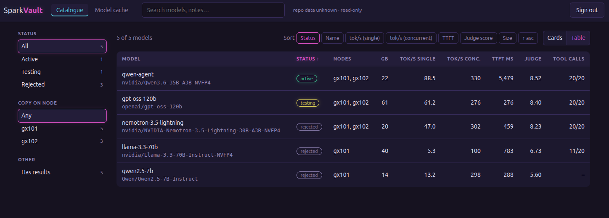
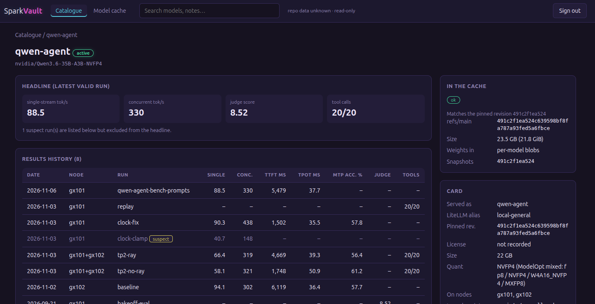

# SparkVault: deploy and use

This is the how-to. For what SparkVault is and why it exists, see the [README](README.md).

Contents: [What you need](#what-you-need) · [Deploy](#deploy) · [Settings](#settings-in-sparkvaultenv) ·
[Update](#update) · [Put your data in](#put-your-data-in) · [Use the app](#use-the-app) ·
[Get results in](#get-results-in) · [Day-to-day workflow](#day-to-day-workflow) · [Troubleshooting](#troubleshooting)

## What you need

- A server that runs Docker with Compose. SparkVault has been run on a UGOS NAS; a plain Linux Docker host
  should work the same way but has not been tried.
- The **Hugging Face cache** your GPU nodes use, visible to that server (a shared folder or NFS mount). The
  cache view reads it; nothing is ever written to it.
- A folder for your **catalogue**: `library.yaml` plus a `results/` folder of JSON records. Start from
  [`examples/`](examples/) (see [Put your data in](#put-your-data-in)).
- Python 3 on the machine you copy files from, for the helper scripts (`make-compose.py`, `init-env.sh`,
  the tools). The container needs no Python on the host.

## Deploy

Everything host-specific is either in three marked lines of `docker-compose.yml` (uid/gid, the Hugging Face
folder, the port, filled in by `scripts/make-compose.py` from a small values file) or in one secrets file,
`sparkvault.env`.

**1. Get the code onto the server.** Either way works.

- *Docker host with git:* `git clone https://github.com/jmoe24/sparkvault.git /srv/sparkvault/app` on the server.
- *Anything else (NAS Docker UIs, no git on the server):* clone it on your workstation and copy it over.
  `scripts/sync-app.sh` does the copy: it ships only committed files, dry-runs unless you add `--apply`, and has no
  default destination.

  ```bash
  git clone https://github.com/jmoe24/sparkvault.git && cd sparkvault
  scripts/sync-app.sh --dest /mnt/share/sparkvault/app --init            # dry run, first copy
  scripts/sync-app.sh --dest /mnt/share/sparkvault/app --init --apply
  ```

**2. Lay out your own files next to the code, not inside it.** The code folder is replaced on every update, so
anything of yours inside it would be lost. A layout that works:

```
/srv/sparkvault/
  app/                    <- the code (git clone or sync-app.sh). Never edit inside it.
  docker-compose.yaml     <- generated from app/docker-compose.yml by scripts/make-compose.py
  sparkvault.env          <- secrets, mode 600
  catalogue/              <- your library.yaml and results/
  inbox/                  <- writable, uploads land here
```

**3. Create the secrets file.** From a clone, `scripts/init-env.sh /srv/sparkvault/sparkvault.env` asks for your
node names and an admin password, generates the session secret, and stores only a scrypt hash of the password
(mode 600). Or copy `sparkvault.env.example` and fill it in by hand.

**4. Create your compose file.** `docker-compose.yml` in this repo is the one source; you don't hand-edit a copy.
Only three values belong to your host, and the lines carrying them are marked `# @sv <name>`:

| Value | Meaning |
|---|---|
| `user` | The uid:gid that owns your folders. Check with `ls -ldn` on the server: an NFS-exported share can look open while the underlying filesystem is not. |
| `hf_dir` | The Hugging Face cache root, outside your folder. |
| `port` | Only if 8080 is taken. |

Everything else is a relative path inside your folder. Put the three values in a small file (see
`deploy.example.conf`; keep your real one outside this repo) and generate the compose file:

```bash
scripts/make-compose.py --values deploy.conf --out /srv/sparkvault/docker-compose.yaml          # shows a diff
scripts/make-compose.py --values deploy.conf --out /srv/sparkvault/docker-compose.yaml --apply  # writes it
scripts/make-compose.py --values deploy.conf --out /srv/sparkvault/docker-compose.yaml --check  # exit 1 on drift
```

It rewrites only the marked lines, validates the values, keeps the old file as `.bak`, and `--check` is how you
notice that the deployed file no longer matches the repo's. Relative paths need your Docker or NAS UI to run the
file from its own folder; if the catalogue page lists no models, the UI is running a copy from somewhere else.

**5. Start it:** `docker compose up -d --build`, or select the compose file in your NAS's Docker/Project UI.

**6. Check it.** Open `http://<server>:<port>/` and sign in with the admin password from step 3. `/healthz`
answers without a login. If the page is empty or errors, see what the container sees:

```bash
docker exec sparkvault sh -c 'id; ls -ldn /catalogue /hf /inbox'
```

On a UGOS NAS this runs by building from the copied folder; building straight from a GitHub URL
(`context: https://github.com/...`) fails there because the NAS's Docker has no `git`.

### Settings in `sparkvault.env`

| Variable | Meaning |
|---|---|
| `SPARKVAULT_SECRET_KEY` | **Required.** Signs the session cookie (32+ characters). |
| `SPARKVAULT_ADMIN_HASH` | **Required.** scrypt hash of the admin password (`python3 -m app.hashpw`). |
| `SPARKVAULT_NODES` | Node names for the filter and for result records, e.g. `spark-1,spark-2`. Default `node-a,node-b`. |
| `SPARKVAULT_INGEST_TOKEN` | Turns result upload on (32+ chars). Empty = the endpoint returns 404. |
| `SPARKVAULT_COOKIE_SECURE` | Set to `1` once served over HTTPS. |

The app refuses to start without a session secret and an admin hash.

## Update

`git pull` (or on your workstation `git pull`, then `scripts/sync-app.sh --dest ... --apply`), then restart the
project: the code is mounted into the container, so a restart picks it up. Rebuild only when `requirements.txt`
or the `Dockerfile` change. If `docker-compose.yml` itself changed, run `make-compose.py` again (`--check` tells
you) and recreate the container.

## Put your data in

SparkVault shows what is in your catalogue folder and nothing else. The catalogue is two things:

- **`library.yaml`**: one entry per model you run, try or reject (id, Hugging Face repo, status
  `active|testing|rejected`, pinned revision, which nodes hold a copy, notes, an optional serve `recipe`). See
  [`examples/library.yaml`](examples/library.yaml).
- **`results/*.json`**: one file per benchmark, eval or replay run, named after its `id`. Schema:
  [`app/results.schema.json`](app/results.schema.json); examples in [`examples/results/`](examples/results/).
  `node` is any name from `SPARKVAULT_NODES`, or two joined with `+` for a two-node run.

A malformed file is skipped and listed at the top of every page; it never takes the app down.

Keep the catalogue in its own git repo (private if it names your nodes and paths). Start from the examples:

```bash
cp -r examples ~/my-catalogue            # edit library.yaml, add your own results/
cd ~/my-catalogue && git init            # your own repo; the app only reads the files
```

Copy it to the server with `scripts/sync-catalogue.sh`. It takes a destination **you** choose (a mounted share or
`user@host:/path`), dry-runs unless you add `--apply`, and validates your records first:

```bash
scripts/sync-catalogue.sh --src ~/my-catalogue --dest /mnt/share/sparkvault/catalogue --init          # dry run
scripts/sync-catalogue.sh --src ~/my-catalogue --dest /mnt/share/sparkvault/catalogue --init --apply
```

`--init` is only for the first copy into an empty folder. Later syncs drop `--init`. The sync removes files from
the destination's `results/` that are not in the source, so a record you delete disappears from the site. The
container mounts the catalogue read-only and re-reads it when files change, so no restart is needed.

### Recipes

A **recipe** is a vLLM serve command stored as data. `tools/check-recipes.py` renders each recipe with the app's own
renderer and compares it token for token with the command in your launch script (`golden.script`), so the
catalogue cannot drift from what you actually run:

```bash
python3 tools/check-recipes.py                                   # the shipped examples
python3 tools/check-recipes.py --catalogue ~/my-catalogue --root ~/path/to/your/launch-scripts
```

## Use the app

Sign in at the server's address. There are two pages in the top bar, plus a search box.

**Catalogue** (the front page) lists every model with its headline numbers: single-stream and concurrent
tokens per second, time to first token, judge score, and tool-call results. Switch between **Table** and
**Cards** at the top right. The left-hand filters narrow by **status** (active, testing, rejected), by **which
node holds a copy**, and by **has results**. Sort by status, name, either tokens/s figure, TTFT, judge score or
size, and flip the direction with the asc/desc toggle. The search box matches model names and notes.



**Model page** (click a model). The headline box shows the latest valid run. Below it is the full results
history, the per-prompt judge evaluations (collapsed until you open them), the recipe with its rendered
command, the cache state, and the model card. A run marked **suspect** (for example one made while the GPU clock
was clamped) is listed with its reason but never used for the headline. A run uploaded but not yet committed to
your catalogue shows as **pending**.



**Model cache** compares the catalogue with the Hugging Face cache on your shared storage, per model, and lists
cached models the catalogue does not mention. It is read-only: nothing on this page changes either side. States:

| State | Meaning |
|---|---|
| `ok` | The cache matches the revision the catalogue pins. |
| `drift` | The cache's `refs/main` differs from the pinned revision. |
| `unpinned` | The model is cached, but the catalogue pins no revision. |
| `broken` | Broken symlinks or `.incomplete` files in the cache. |
| `missing` | The catalogue says it is in the cache, but it is not. |
| `absent` | Not in the cache (and the catalogue does not say otherwise). |
| `stale` | Present and matching, but the catalogue says it is not on the shared storage (`on_nas: false`). |

SparkVault is read-only everywhere: the one thing it ever writes is its inbox folder of uploaded records. It does
not deploy models: the Deploy box on a model page points you to the Ansible playbooks.

## Get results in

A result record is a small JSON file. You can write one by hand, produce one with the tools below, or let a
benchmark job upload it.

### Measure a model

`tools/bench-vllm.sh` measures a running vLLM container and, with `BENCH_JSON=out.json`, writes the `bench` block of a
record. Run it on the GPU node (it talks to `localhost:8000` by default); it needs `VLLM_API_KEY` in the environment
plus `curl`, `jq`, `bc` and `docker`.

- Output tokens/s come from the server's own `vllm:generation_tokens_total` counter, not from `vllm bench serve`,
  which counts only visible text and so undercounts reasoning models (gpt-oss reported about a third of what it
  generated). A run that generated fewer than 95% of the requested tokens is written with `complete: false`.
- `BENCH_DATASET=prompts` sends the long-form questions in `tools/bench-prompts.jsonl` instead of random tokens,
  which some models answer briefly (about 170 of 256 tokens for gpt-oss-120b). **Numbers are comparable only within
  one dataset**, so say which you used in the record's `source`.

Other record builders: `tools/replay-record.py` turns the output of a tool-call replay into a record, and judge
evaluations are an `eval` block (`prompt_set`, `judge`, `overall_score`, optional `per_category` and per-prompt
scores) in a record with its own `id`, `model`, `node` and `source`. SparkVault displays them; how you run the judge
is up to you.

### Upload a record

```bash
SPARKVAULT_URL=http://host:8080 SPARKVAULT_INGEST_TOKEN=... tools/submit-result.sh record.json
```

- **Auth:** `Authorization: Bearer <SPARKVAULT_INGEST_TOKEN>`. No session or cookie is accepted on this route,
  and it is off (404) unless a token of at least 32 characters is set. Five wrong tokens from one address lock it
  for a minute.
- **Accepts:** one JSON object, at most 64 KB, valid against the schema, whose `model` is in `library.yaml`, whose
  `id` is only letters, digits and `. _ + -` (it becomes a file name), and which does not already exist. Replies:
  `201` stored, `401` bad token, `409` id exists, `413` too big, `422` invalid, `503` inbox not writable. The
  reply never echoes the body.
- **Writes:** only `<inbox>/<id>.json`, created exclusively (never overwrites). The container stays read-only;
  `/inbox` is its one writable mount (create it and give it to the `user:` set in the compose file first).
- **Transport:** plain HTTP, like the login. Anything that can sniff that network segment can read the token, so it
  only buys "accepts schema-valid records into a quarantine folder". Terminate TLS in front of it before you
  widen who can reach it.

### Make an uploaded record permanent

Uploads show as **pending** until you commit them to the catalogue:

```bash
python3 tools/import-results.py --catalogue ~/my-catalogue /path/to/inbox          # dry run
python3 tools/import-results.py --catalogue ~/my-catalogue /path/to/inbox --apply  # copy the valid ones
```

It skips records whose id already exists (`--replace` overwrites; use it on purpose). Then commit the catalogue and
sync it again; the committed record replaces the pending one (same id). `tools/results-report.py --catalogue DIR`
renders the whole catalogue as one Markdown report if you want a document as well as the site.

### Automate it with Ansible

[`ansible/`](ansible/README.md) holds playbooks that bring a model up on your GPU nodes, benchmark it, and file the
result in the inbox in one run, with a rollback to your standing model afterwards. Node setup, variables and
usage are in its README.

## Day-to-day workflow

1. Serve a candidate on a node (by hand, or `ansible/playbooks/vllm_deploy.yml`).
2. Benchmark it (`tools/bench-vllm.sh`, or `-e sv_bench=true` in the playbook). The record is uploaded to the inbox
   and shows as pending.
3. Run your quality evals and tool-call checks if you use them; add their records the same way.
4. On the one machine that edits the catalogue: `import-results.py --apply`, update `library.yaml` (status, notes),
   commit, push, and `sync-catalogue.sh --apply`.
5. Roll the node back to your standing model.

Keep one machine as the only writer to the catalogue repo, so two people or hosts never commit competing changes.

## Troubleshooting

- **Container exits at start:** `SPARKVAULT_SECRET_KEY` or `SPARKVAULT_ADMIN_HASH` is missing. `docker logs
  sparkvault` says which.
- **The catalogue page lists no models:** the container is not seeing your `library.yaml`. Check the mounts with the
  `docker exec` command above. On NAS UIs, the project may be running a copy of the compose file from another folder.
- **A banner at the top lists problems:** a catalogue file failed validation. The named file is skipped; fix or remove it.
- **Cache page shows `absent` or `missing` for every model:** `hf_dir` points at the wrong folder, or the container's
  user cannot read it.
- **Upload returns 404:** `SPARKVAULT_INGEST_TOKEN` is empty. **401:** token mismatch. **503:** the inbox folder is
  not writable by the container's user.
- **A record you deleted from `results/` is still on the site:** sync again; the sync removes files that are gone
  from the source.
- **Forgot the admin password:** run `python3 -m app.hashpw` for a new hash, put it in `sparkvault.env`, restart.

If you find a vulnerability, please open a private security advisory on GitHub rather than a public issue.
