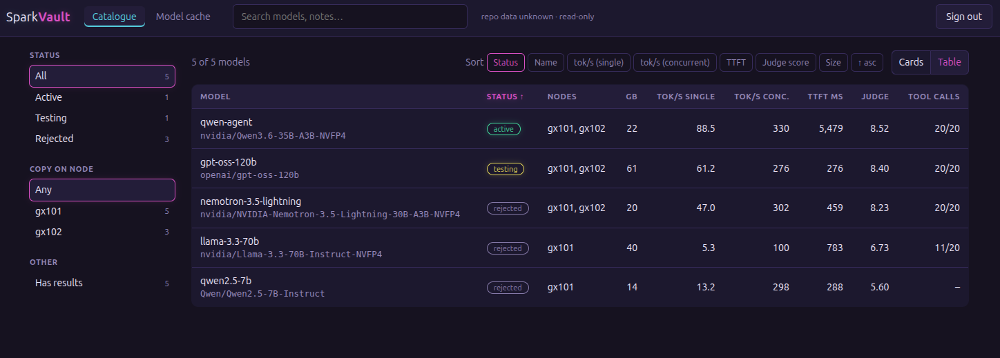
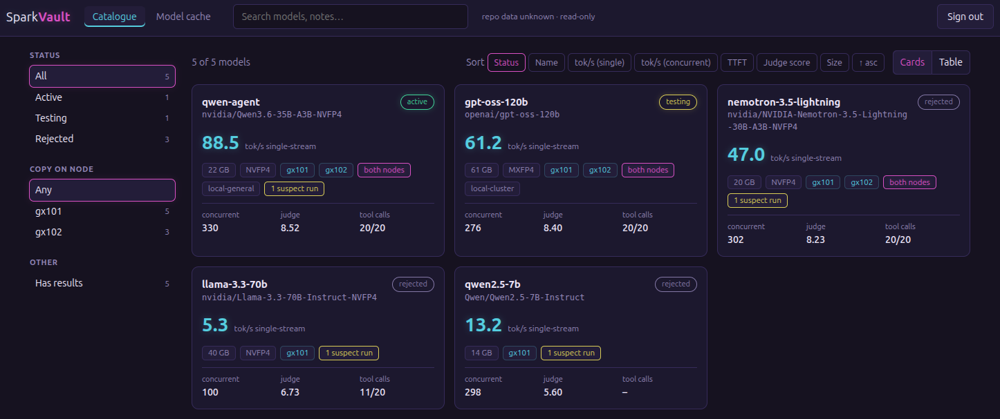
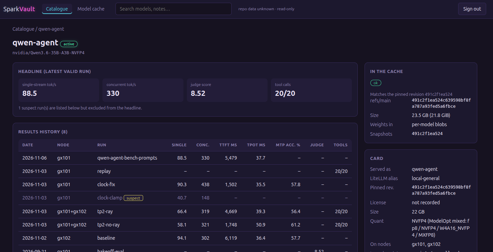

# SparkVault

**A self-hosted registry of the models you run on your own GPUs, and what they actually do there.**

SparkVault keeps one place for the answers you otherwise lose in terminal scrollback and chat logs: which models
you have tried, which one is live, how fast each runs on *your* nodes, how well it answers, whether it handles
tool calls, and whether the weights on disk are the ones you think they are. It is built for small teams and home
labs that serve open-weight models with [vLLM](https://github.com/vllm-project/vllm) (it was built on NVIDIA GB10
"Spark"-class boxes and is not tied to them).



## Why a self-hosted registry

**The numbers that matter are the ones from your hardware.** Throughput and quality depend on the node, the driver,
the container image, the serve flags and even the GPU clock. A leaderboard cannot tell you what a model does on
your box. SparkVault records each run with where and how it was made, so you can compare models fairly and look
back later.

**Measurements go wrong, and the record should say so.** In the data behind the screenshots, one run on a
clamped GPU clock reported 40.7 tokens/s for a model that does 90.3 once the clock was fixed. Another benchmark
tool counted only visible text and reported about a third of what a reasoning model really generated.
SparkVault keeps both runs, marks the first one **suspect** with its reason, and never uses a suspect run as a
model's headline number. Provenance travels with every result: dataset, topology, recipe commit, GPU clock.

**Your data stays plain files you own.** The catalogue is a `library.yaml` and a folder of JSON records. You keep it in
your own git repo, review changes like code, and back it up like code. There is no database and nothing to migrate.
The app only reads those files.

**Large model files drift quietly.** Weights are tens of gigabytes, copied between nodes and a shared cache. The
cache view compares the catalogue with the Hugging Face cache on your storage and flags a revision that moved,
broken links, interrupted downloads and models that are catalogued but absent.

**It runs where your models live, and trusts almost nothing.** It is a small server-rendered web app (no
JavaScript) meant for a trusted network, for example the NAS next to your GPU nodes. It is read-only: one admin
login, read-only mounts, and the one thing it ever writes is an inbox folder of uploaded results. It holds no
credential for git, your nodes or Hugging Face, and calls no external service.

**It is the record, not the runtime.** SparkVault does not serve models, schedule jobs or deploy anything from its
UI. The companion Ansible playbooks in [`ansible/`](ansible/README.md) do the deploying and benchmarking on your
nodes and file the results here.

## What you get

- A **catalogue** of the models you run, try and reject, with status, pinned revision, which nodes hold a copy, notes,
  and serve recipes kept as data. A recipe is checked token for token against your real launch script, so the
  catalogue cannot silently disagree with what you run.
- **Benchmark, eval and replay results** per model and node, with a headline number per model, the full history, and
  per-prompt judge evaluations.
- A **cache drift view** against the Hugging Face cache on your shared storage.
- An optional, token-protected **result upload** endpoint so benchmark jobs can file their own records, which wait as
  *pending* until you commit them.
- Tools to measure a model, build records, import uploads and render a Markdown report, and **Ansible playbooks** that
  deploy a model, benchmark it, record the result and roll the node back.





## Get started

[**INSTRUCTIONS.md**](INSTRUCTIONS.md) covers deploying it (Docker, including on a NAS), loading
your catalogue, using each page, getting results in, and troubleshooting. The playbooks have their own guide in
[`ansible/README.md`](ansible/README.md).

## Status: v1

SparkVault v1 reads and records; it does not deploy from the UI. What has been exercised:

- The app and its 63 tests pass. The container runs on a UGOS NAS using the layout in INSTRUCTIONS.md and came
  back correctly after a NAS reboot.
- The Ansible playbooks have run against a real two-node setup: status, rollback, redeploying the standing model,
  and deploying, benchmarking and rolling back a candidate, with the record uploaded to the inbox and imported.

Known limits:

- Plain-Linux Docker hosts are untested (only the NAS layout has been run).
- The two-node cluster playbook has been run for `status` only; `up` and `down`, including their firewall check,
  have not been exercised in this form.
- One admin account, and plain HTTP: terminate TLS in front of it before widening who can reach it, and set
  `SPARKVAULT_COOKIE_SECURE=1` once you do.
- Tool-call replay and Claude-judge evals are produced outside this repo; SparkVault stores and displays their
  records. A judge harness that writes only an `eval` block needs its record's `id`, `model`, `node` and `source`
  added before it is imported.
- The playbooks expect your launch scripts at `scripts/run-vllm.sh` and `scripts/candidates/<name>.sh` in a recipes
  clone on each node, and fixed head/worker roles for the two-node cluster.

## Security model

SparkVault is built for a trusted, self-hosted network, not the open internet.

- One admin login: scrypt hash from the environment, signed session cookie, CSRF token on every POST, five failures
  lock an address out for a minute. It **refuses to start** without a session secret and an admin hash.
- Read-only mounts, read-only root filesystem, all capabilities dropped, `no-new-privileges`.
- Content-Security-Policy with no inline script or style; catalogue text is escaped (tested).
- If you find a vulnerability, please open a private security advisory on GitHub rather than a public issue.

## Development

```bash
python3 -m venv .venv && .venv/bin/pip install -r requirements-dev.txt
.venv/bin/python -m pytest -q
.venv/bin/python tools/check-recipes.py
```

Try the app against your own cache without Docker:

```bash
export SPARKVAULT_ADMIN_HASH="$(.venv/bin/python -m app.hashpw)"   # prompts for a password
export SPARKVAULT_SECRET_KEY="$(openssl rand -hex 32)"
export SPARKVAULT_CATALOGUE_DIR=$PWD/examples SPARKVAULT_HF_DIR=/path/to/huggingface SPARKVAULT_DATA_DIR=/tmp
.venv/bin/uvicorn app.main:app_factory --factory --host 127.0.0.1 --port 8081
```

| Path | What |
|---|---|
| `app/` | The web app (FastAPI + Jinja, server-rendered, no JavaScript) and the result schema. |
| `tests/` | Auth/CSRF/lockout, filters and sorting, drift states against mock caches, bad data never crashes the app, output escaping, the golden recipe check, upload. |
| `examples/` | A sample catalogue, results and launch scripts to copy and edit. |
| `ansible/` | Playbooks: deploy a model, benchmark it, record and upload the result ([README](ansible/README.md)). |
| `tools/` | `check-recipes.py`, `import-results.py`, `results-report.py` (Markdown report), `replay-record.py`, `bench-vllm.sh` (+ `bench-prompts.jsonl`), `submit-result.sh`. |
| `scripts/` | `init-env.sh` (creates `sparkvault.env`), `make-compose.py`, `sync-app.sh` (copies the app to your server), `sync-catalogue.sh` (copies your catalogue). |
| `docs/images/` | Screenshots used in this README and INSTRUCTIONS.md. |
| `Dockerfile`, `docker-compose.yml`, `sparkvault.env.example`, `deploy.example.conf` | Container files. |
